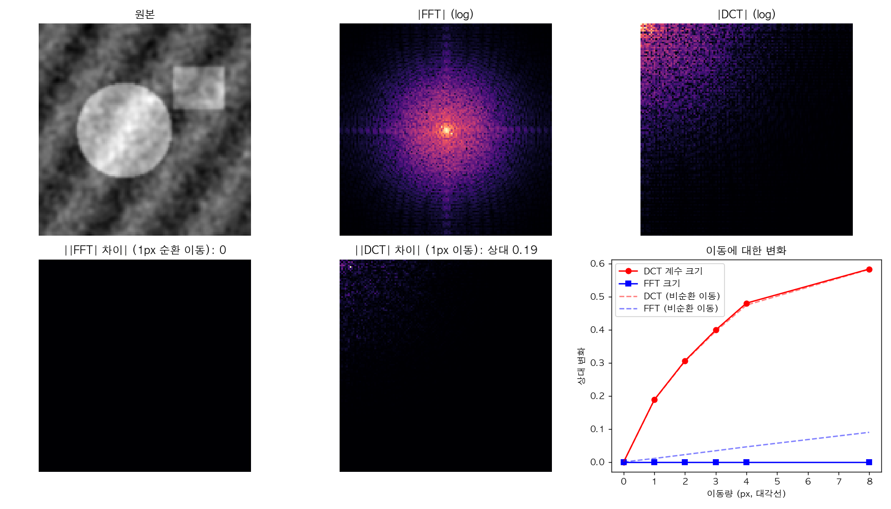
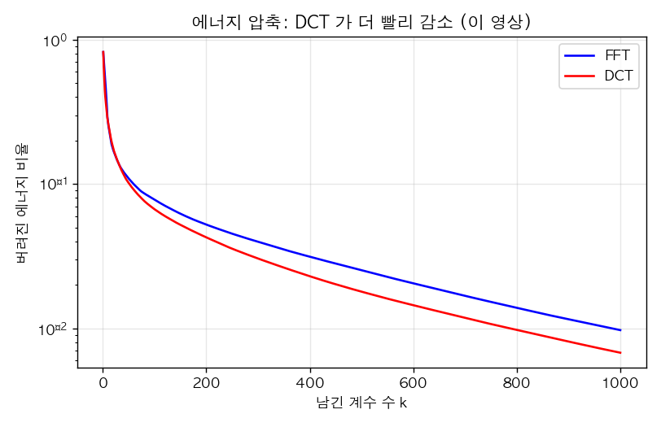
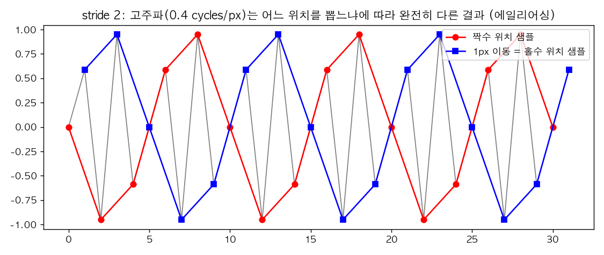
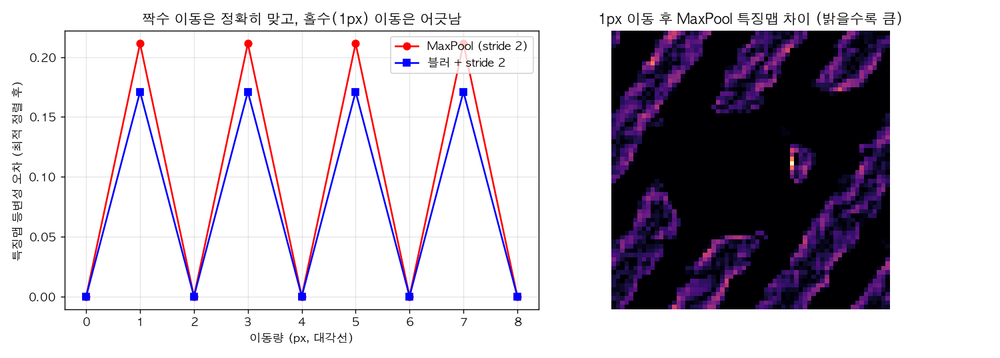

# picz-FFT-DCT-Shift-Invariance

> **시프트(이동) 불변성**: 입력을 1픽셀만 옮겨도 AI 가 다른 답을 내는 이유. FFT 크기는 이동에 불변이지만 DCT 계수는 아니고, 스트라이드·풀링을 쓰는 CNN 도 엄밀히는 불변·등변이 아니다.

## 🎬 영상

[](https://youtu.be/53K1ECyRNBw)

**1픽셀 이동에 AI가 당황하는 이유? 시프트 불변성과 딥러닝** — https://youtu.be/53K1ECyRNBw
(해시태그: #픽셀 #AI #shift #불변성 #딥러닝)

> ⚠️ 영상 본문(자막·설명)은 읽지 못했고 확인된 것은 제목과 해시태그뿐입니다. 아래는 제목이 가리키는 주제(시프트 불변성, 딥러닝)와 이 저장소 이름(FFT·DCT)에 맞춘 표준 이론, 그리고 `shift_demo.py` 로 직접 계산한 실험으로 구성했습니다. 영상의 구체적 전개와 다를 수 있습니다.

## 1. 용어: 불변성 vs 등변성

| 용어 | 정의 | 예 |
|---|---|---|
| 이동 **불변** (invariance) | f(T x) = f(x) | 분류(고양이는 어디에 있어도 고양이) |
| 이동 **등변** (equivariance) | f(T x) = T f(x) | 합성곱(특징맵이 입력과 함께 이동) |

이상적인 CNN: 합성곱 층은 등변, 마지막 전역 풀링에서 불변. 그런데 **스트라이드/풀링(다운샘플링)이 이 구조를 깨뜨립니다.**

## 2. FFT 는 이동 불변(크기), DCT 는 아니다

푸리에 쉬프트 정리: x[n−s] 의 DFT = X[k]·e^{−2πiks/N}. **위상만 돌고 크기는 그대로**입니다. DCT 는 짝대칭 연장의 코사인 기저를 쓰므로 이런 깔끔한 성질이 없고, 이동하면 계수가 비단순하게 섞입니다.



128×128 합성 영상(원, 사각형, 줄무늬, 질감)을 (s,s) 대각선으로 이동했을 때 계수 크기의 상대 변화:

| 이동 s (px) | 0 | 1 | 2 | 3 | 4 | 8 |
|---|---|---|---|---|---|---|
| \|FFT\| (순환 이동) | 0 | **0** | 0 | 0 | 0 | 0 |
| \|DCT\| (순환 이동) | 0 | **0.188** | 0.306 | 0.399 | 0.480 | 0.583 |
| \|FFT\| (비순환 이동) | 0 | 0.011 | 0.022 | 0.034 | 0.046 | 0.090 |
| \|DCT\| (비순환 이동) | 0 | 0.188 | 0.304 | 0.395 | 0.474 | 0.582 |

- **순환(주기) 이동에서 FFT 크기는 정확히 불변**(오차 0), DCT 는 1픽셀만 옮겨도 19% 변합니다.
- 실제 이미지의 이동은 경계로 물체가 나가고 들어오는 비순환 이동이라 FFT 크기도 완전 불변은 아니지만(1픽셀당 약 1%), DCT 보다 훨씬 덜 변합니다.
- 함의: **FFT 크기 특징은 위치에 둔감(위상은 위치 정보를 가짐)**, DCT 계수 특징(예: JPEG 형태의 압축 영역 입력, DCT 기반 특징)은 이동에 민감합니다.

### 대신 DCT 는 에너지 압축이 좋다



같은 영상에서 상위 k 개 계수가 담는 에너지: k=100 에서 FFT 92.2%, DCT 93.3%; k=500 에서 FFT 97.5%, DCT 98.2%. DCT 가 조금 더 압축적입니다(경계 불연속 처리 덕분). 이 합성 영상 한 장의 결과이므로 격차의 크기는 영상마다 다릅니다.

## 3. 딥러닝이 1픽셀에 흔들리는 이유: 스트라이드와 에일리어싱

stride 2 풀링은 2칸마다 한 칸만 남기는 **샘플링**입니다. 샘플링 전에 나이퀴스트를 넘는 고주파를 제거하지 않으면 에일리어싱이 생기고, 입력을 1픽셀 옮기면 어느 샘플을 뽑는지가 바뀌어 **전혀 다른 값**이 됩니다.



0.4 cycles/px 의 신호를 stride 2 로 뽑을 때, 짝수 위치(빨강)와 1px 이동한 홀수 위치(파랑)가 서로 다른 파형을 만듭니다.

### 고정 랜덤 합성곱 + ReLU + MaxPool(stride 2)로 확인

학습 없이 5×5 랜덤 필터 8개 → ReLU → MaxPool 2, stride 2 를 입력 이동에 대해 검사했습니다(이동 후 특징맵을 가능한 한 가장 잘 정렬해 비교).



| 이동 | 짝수(0,2,4,6,8 px) | 홀수(1,3,5,7 px) |
|---|---|---|
| MaxPool 등변성 오차 | **0** | **0.211** |
| 블러 + stride 2 (BlurPool) | 0 | 0.171 |

- 이동량이 스트라이드(2)의 배수일 때만 특징맵이 정확히 같이 이동하고, **1픽셀 이동에서는 21% 달라집니다.** 그림의 오른쪽은 1px 이동 후 어긋나는 위치(질감·경계)를 보여 줍니다.
- 샘플링 전에 저역통과(블러)를 넣는 BlurPool(Zhang, ICML 2019)은 이 값을 0.211→0.171 로 줄였지만 이 설정(약한 가우시안 σ=1, 랜덤 필터)에서는 개선이 **작았고** 완전히 해결하지 못했습니다.
- **한계**: 학습된 네트워크가 아니라 고정 랜덤 필터이며, 실제 분류기의 오답률을 측정한 것이 아닙니다. "1px 이동으로 분류가 뒤집힌다"는 현상 자체는 문헌(Azulay & Weiss, JMLR 2019; Zhang, ICML 2019)에 보고된 것이며 여기서 재현하지 않았습니다.

## 4. 불변성을 높이는 방법 (문헌 기반 요약)

- 다운샘플링 전 안티에일리어싱(BlurPool), 적응적 폴리페이즈 샘플링(APS, Chaman & Dokmanić 2021)
- 이동에 불변인 특징 사용: FFT 크기 스펙트럼 등
- 데이터 증강(이동·크롭), 스트라이드 대신 학습 가능한 저역통과를 포함한 설계
- 이동에 대한 완전한 등변·불변이 필요하면 주기 경계(순환 합성곱)와 다운샘플링 격자 정렬 조건을 함께 맞춰야 함

## 5. 재현
```bash
pip install numpy scipy matplotlib
python shift_demo.py   # figures/*.png 생성, 표의 수치 출력
```

## 참고
- Azulay & Weiss, *Why do deep convolutional networks generalize so poorly to small image transformations?*, JMLR 2019
- Zhang, *Making Convolutional Networks Shift-Invariant Again*, ICML 2019
- Chaman & Dokmanić, *Truly shift-invariant convolutional neural networks*, CVPR 2021
