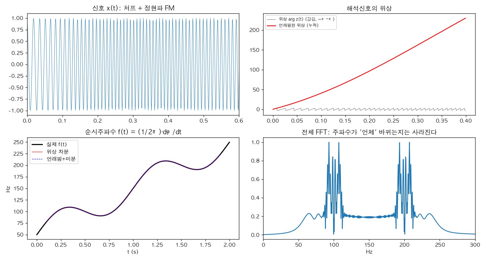
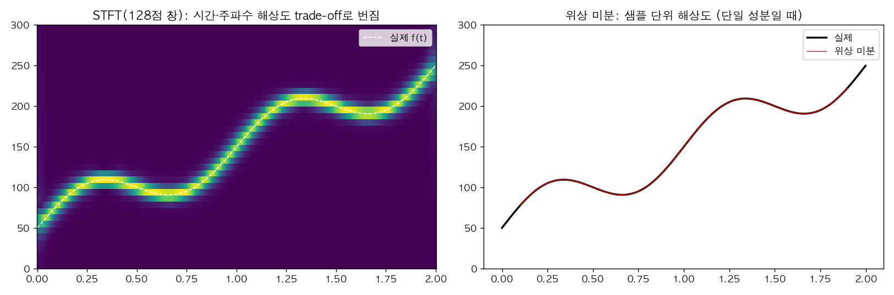
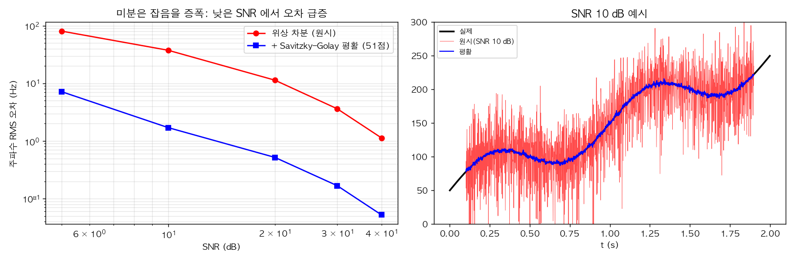
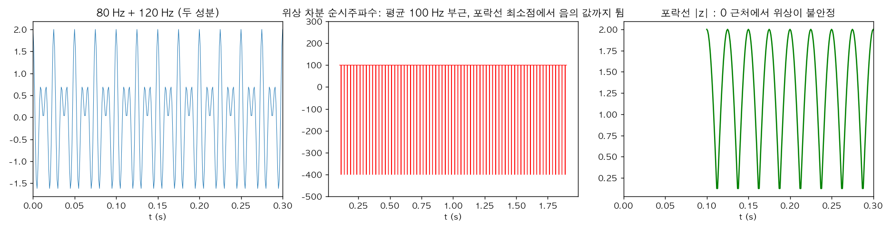

# picz-phase-diff-instantiate-frequency

> **순시주파수(instantaneous frequency)** = 위상의 시간 미분. 해석신호의 위상을 미분하면 "지금 이 순간의 주파수"를 샘플 단위로 얻을 수 있다 — 그리고 그 미분이 왜 잡음에 약하고 다성분 신호에서 무너지는지.

## 🎬 영상

[](https://youtu.be/_RvlR1bZ0Jk)

**AI 신호 분석의 혁신, 위상 미분과 순시주파수 정복하기** — https://youtu.be/_RvlR1bZ0Jk
(해시태그: #Phase #differentiation #instantaneous #frequency #순시주파수 #위상미분 #위상)

> ⚠️ 영상 본문(자막·설명)은 읽지 못했고 확인된 것은 제목과 해시태그뿐입니다. 아래는 제목이 가리키는 주제(위상 미분으로 순시주파수 구하기)의 표준 이론과 `if_demo.py` 로 직접 계산한 실험으로 구성했습니다. 영상이 "AI 신호 분석"에서 구체적으로 어떤 모델·응용을 다루는지는 확인하지 못했고, 아래 AI 관련 문장은 일반론입니다.

## 1. 아이디어

푸리에 변환은 신호 전체의 주파수 성분을 알려 주지만 **주파수가 언제 바뀌는지**는 잃습니다. 그런데 신호가 한 개의 진동처럼 행동한다면, 시각 t 의 위상 φ(t) 가 얼마나 빨리 변하는지가 곧 그 순간의 주파수입니다.

`f(t) = (1/2π) · dφ(t)/dt`

실수 신호 x(t) 에서 위상을 얻으려면 **해석신호** z(t) = x(t) + i·H[x](t) = A(t)e^{iφ(t)} (H = 힐베르트 변환; 음의 주파수를 제거해 얻으므로 rfft 의 에르미트 대칭 정리와 같은 뿌리)를 만들고 `φ = arg z` 로 읽습니다.

## 2. 구현: 위상 차분 vs 언래핑 + 미분

arg z 는 [−π, π) 로 감겨 있어 그대로 미분하면 ±2π 점프가 생깁니다. 두 방법:

- **언래핑 후 미분**: `np.unwrap(np.angle(z))` → 기울기
- **위상 차분(권장)**: `angle(z[n+1]·conj(z[n]))·fs/2π` — 인접 샘플의 위상 차이를 곱셈으로 바로 구하므로 언래핑이 필요 없고 점프에 강합니다.



2초(fs=1 kHz) 신호: 50→250 Hz 로 오르는 처프에 1 Hz 정현파 FM(±30 Hz)을 얹었습니다.
- **위 오른쪽**: 감긴 위상(회색 톱니)과 언래핑한 위상(빨강). 기울기가 주파수입니다.
- **아래 왼쪽**: 두 방법 모두 실제 f(t)(검정)와 겹칩니다. 잡음 없을 때 RMS 오차 — 위상 차분 0.047 Hz, 언래핑+미분 0.080 Hz (힐베르트 변환의 경계 100샘플 제외).
- **아래 오른쪽**: 같은 신호의 전체 FFT. 두 개의 넓은 덩어리만 보이고 주파수가 시간에 따라 어떻게 움직이는지는 알 수 없습니다.

## 3. STFT 와 비교



STFT(128점 창)는 창 길이에 의해 시간·주파수 해상도가 서로 교환(불확정성)되어 번지고, 위상 미분은 단일 성분 신호에서 **샘플 단위**의 해상도를 줍니다. 단, 아래 두 절에서 보듯 이는 조건부입니다.

## 4. 한계 ① 미분은 잡음을 증폭한다



같은 신호에 가우시안 잡음을 더해(각 SNR 10회 평균) 주파수 RMS 오차를 쟀습니다.

| SNR (dB) | 40 | 30 | 20 | 10 | 5 |
|---|---|---|---|---|---|
| 위상 차분(원시) | 1.13 Hz | 3.63 | 11.38 | 37.55 | 80.74 |
| + Savitzky–Golay 평활 (51점) | 0.05 Hz | 0.17 | 0.52 | 1.71 | 7.19 |

- 미분은 고주파 잡음에 이득이 큰 연산이므로 SNR 이 낮을수록 오차가 급격히 커집니다. 평활(저역통과)을 함께 쓰면 오차가 크게 줄지만, 평활창이 길수록 빠른 주파수 변화를 둔화시키는 트레이드오프가 있습니다.
- 그림 오른쪽은 SNR 10 dB 에서 원시(빨강, 들쭉날쭉)와 평활(파랑) 추정.

## 5. 한계 ② 다성분 신호에서는 의미를 잃는다



80 Hz 와 120 Hz 두 정현파를 더하면 "하나의 순시주파수"가 존재하지 않습니다. 해석신호의 포락선이 0 근처(최소 0.126)로 내려가는 순간 위상이 급변해, 위상 차분 추정이 평균 부근(100 Hz)과 **음의 주파수(−400 Hz 까지)** 사이를 튑니다(이 실행에서 1~99 백분위 범위 −400~100 Hz). 해결책: 대역통과/모드 분해(EMD, VMD, 웨이블릿 등)로 **성분을 먼저 분리**한 뒤 성분별 순시주파수를 구하는 것이 일반적입니다.

## 6. 응용 (일반론)
- FM 복조(순시주파수 = 메시지), 레이더·소나의 도플러 추정, 진동·회전기계 진단(속도 변화 추적), 음성 피치 추적, 뇌파·심전도의 시변 리듬 분석, 지진·전력계통 주파수 감시.
- 딥러닝 입력/특징으로 위상 정보를 쓰는 연구(위상 미분을 특징으로 삼는 음성 합성, 위상 정보 보존 등)가 있으나, 영상이 어떤 구체적 사례를 다루는지는 확인하지 못했습니다.

## 7. 재현
```bash
pip install numpy scipy matplotlib
python if_demo.py   # figures/*.png 생성, 오차·표 수치 출력
```

## 참고
- Boashash, *Estimating and Interpreting the Instantaneous Frequency of a Signal*, Proc. IEEE 1992
- Huang et al., *The empirical mode decomposition and the Hilbert spectrum*, Proc. R. Soc. A 1998
- Cohen, *Time-Frequency Analysis*, Prentice Hall 1995
