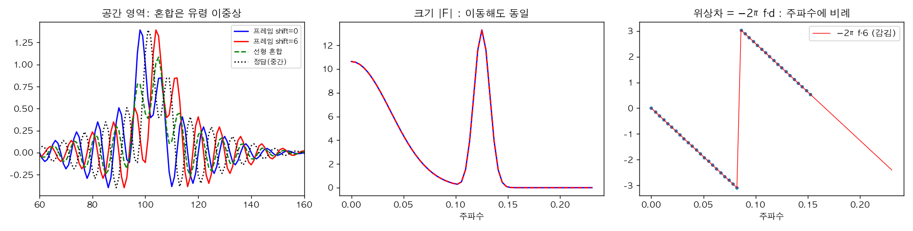
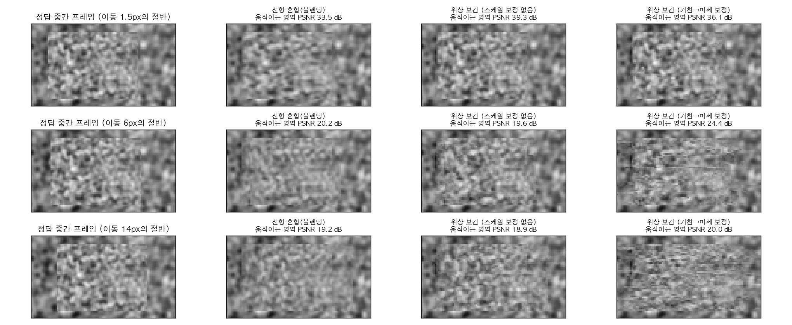

# picz-fourier-frame-interpolation

> 영상 프레임 보간을 **픽셀 이동(광학 흐름) 대신 위상(phase)** 으로 한다: 푸리에 쉬프트 정리에 따라 움직임은 위상차로 나타나므로, 위상의 절반만 옮기면 중간 프레임이 된다.

## 🎬 영상

[](https://youtu.be/VeefOb7DSho)

**픽셀 대신 파동으로? 끊김 없는 고화질 영상의 비밀 PhaseNet** — https://youtu.be/VeefOb7DSho
(해시태그: #프레임 #interpolation #frame #video #wave)

> ⚠️ 영상 본문(자막·설명)은 읽지 못했고 확인된 것은 제목과 해시태그뿐입니다. 아래는 제목이 가리키는 PhaseNet(Meyer et al., CVPR 2018)과 그 전신인 위상 기반 프레임 보간(Meyer et al., CVPR 2015)의 일반 원리, 그리고 이 저장소의 `phase_interp.py` 장난감 구현(신경망 없음, **PhaseNet 재현이 아님**)으로 구성했습니다. 영상의 구체적 설명과 다를 수 있습니다.

## 1. 핵심 원리: 위상이 곧 움직임이다

푸리에 쉬프트 정리: `g(x)=f(x−d) ⟺ G(ξ)=F(ξ)·e^{−2πiξd}`. 이동은 **크기를 바꾸지 않고 위상만 −2πξd 만큼 돌립니다.**



- **왼쪽**: 두 프레임(shift 0, 6)을 선형 혼합(초록 점선)하면 같은 물체가 두 번 반쯤 보이는 "유령 이중상"이 되고 진폭도 줄어듭니다. 정답 중간 프레임(검은 점선)은 선명합니다.
- **가운데**: 이동 전후의 스펙트럼 크기는 같습니다.
- **오른쪽**: 위상차는 주파수에 비례하는 직선(−2πf·d)이며 ±π 에서 감깁니다. 기울기가 이동량입니다. 절반만 이동시키려면 위상차의 **절반**을 쓰면 됩니다.

## 2. 위상 기반 프레임 보간 (Meyer 2015) 요약

1. 두 프레임을 복소 스티어러블 피라미드(여러 스케일·방향의 복소 대역통과 필터)로 분해. 복소 응답 = 진폭 × e^{i·위상}.
2. 각 위치·대역에서 위상차 Δφ = φ₁ − φ₀ 를 구하고, 중간 프레임(t=½)의 위상 = φ₀ + ½Δφ, 진폭은 두 프레임의 평균.
3. 피라미드를 되합성하면 중간 프레임.

한계: 위상은 ±π 에서 감기므로 한 대역이 다룰 수 있는 이동량은 그 대역의 파장의 절반 이하입니다. 큰 이동은 **거친 스케일(긴 파장)의 위상으로 미세 스케일의 위상을 보정**해야 합니다. 대역 중심 주파수가 한 옥타브씩 낮아지면 같은 이동의 위상차는 절반이 되므로, 거친 스케일의 Δφ 의 2배가 미세 스케일의 기대값입니다.

## 3. PhaseNet 이 더한 것 (제목 기준 일반 설명)

- 위상 보간의 한계(큰 이동, 복잡한 질감, 가림)를 사람이 만든 규칙 대신 **신경망이 대역별 위상·진폭 예측을 학습**해 보완하는 구조로 알려져 있습니다(복소 피라미드 위에서 거친→미세로 층별 디코딩).
- 광학 흐름 기반 방법은 흐름 추정 오류가 곧바로 가림·고스팅으로 이어지는 반면, 위상 방식은 흐름을 명시적으로 구하지 않고 **위상 자체가 흐름 역할**을 합니다.
- ⚠️ 학습 데이터, 구조 세부, 정량 성능은 영상·논문을 직접 확인하지 못해 여기 적지 않았습니다.

## 4. 장난감 실험 (`phase_interp.py`)

정지한 질감 배경 위에서 질감 사각형이 수평으로 d 픽셀 이동(서브픽셀은 푸리에 이동으로 정확히 구현). 프레임 0 과 d 에서 중간 프레임(d/2)을 만들고 정답과 비교했습니다. 아래 PSNR 은 **움직이는 영역만**(배경은 정지라 모두 같음) 계산했습니다. 5개 옥타브 대역(수평 주파수 0.25 … 0.016), 수평 이동 전용의 단순화 구현.



| 이동 d (px) | 선형 혼합 | 위상 보간 (보정 없음) | 위상 보간 (거친→미세 보정) |
|---|---|---|---|
| 1.5 | 33.5 dB | **39.3 dB** | 36.1 dB |
| 6 | 20.2 dB | 19.6 dB | **24.4 dB** |
| 14 | 19.2 dB | 18.9 dB | **20.0 dB** |

**읽는 법 (중요)**
- 이동이 작을 때(1.5px)는 위상 보간이 혼합보다 약 6 dB 낫습니다. 이동이 파장 절반 이내라 위상이 감기지 않기 때문입니다. 이 경우 보정은 오히려 손해(잡음 있는 거친 대역의 위상을 따라가기 때문).
- 이동이 커지면(6px) 보정 없는 위상 보간은 혼합보다 못하고, 거친→미세 보정이 이를 크게 개선(+4 dB)합니다.
- 14px 에서는 모든 방법이 20 dB 안팎이며 보정이 약간 낫지만 질감에 줄무늬 아티팩트가 남습니다(그림 3행) — 이 장난감 구현은 큰 이동을 안정적으로 처리하지 못합니다. 이것이 신경망이 필요한 이유(의 일부)입니다.
- 이는 질감이 있는 합성 장면 1개, 수평 이동만, 1회 실행의 결과입니다. 가림(오클루전), 회전, 비강체 운동, 실제 영상의 잡음은 다루지 않았습니다. 일반적 순위로 해석하면 안 됩니다.

## 5. 장단점 정리

| | 위상 기반 | 광학 흐름 기반 |
|---|---|---|
| 큰 움직임 | 어렵다(위상 감김) | 흐름 범위 내 가능 |
| 미세 움직임 | 정확·선명 | 서브픽셀 흐름 추정 필요 |
| 가림 | 약함(위상이 섞임) | 흐름이 틀리면 고스팅 |
| 아티팩트 | 질감 깨짐·링잉 | 경계 왜곡·고스팅 |
| 계산 | 복소 피라미드 | 흐름 추정 + 워핑 |

## 6. 재현
```bash
pip install numpy scipy matplotlib
python phase_interp.py   # figures/*.png 생성, 표의 PSNR 출력
```

## 참고
- Meyer, Wang, Schroers, Sorkine-Hornung et al., *Phase-Based Frame Interpolation for Video*, CVPR 2015
- Meyer, Djelouah, McWilliams, Sorkine-Hornung, Gross, Schroers, *PhaseNet for Video Frame Interpolation*, CVPR 2018
- Simoncelli & Freeman, *The Steerable Pyramid*, 1995
